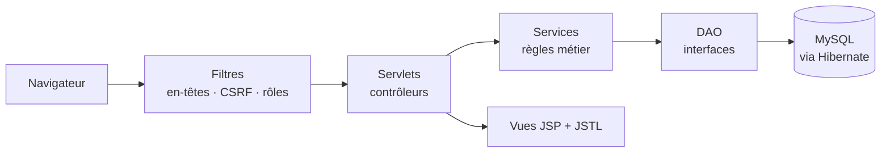

# 🩸 MedConnect — Gestion des dons de sang (Java EE)


MedConnect met en relation les **hôpitaux** qui ont besoin de sang et les **donneurs compatibles**.
Les hôpitaux publient leurs besoins, les donneurs répondent en un clic (« Je veux donner »),
et l'hôpital suit chaque demande jusqu'à ce qu'elle soit satisfaite.

Application web **monolithique MVC** en **Jakarta EE** (Servlets, JSP/JSTL, Hibernate/JPA, MySQL),
avec une attention particulière portée à la **sécurité** et aux **tests**.

---

## Fonctionnalités

### Espace donneur
- Tableau de bord : groupe sanguin, nombre de dons, date du prochain don possible, réponses en cours
- **Demandes compatibles** avec son groupe (pas seulement le même groupe : un O- voit toutes les demandes), triées par urgence, filtre « ma ville »
- Bouton **« Je veux donner »**, suivi de ses réponses (en attente, confirmée, don effectué…) avec le contact de l'hôpital une fois confirmé
- Historique des dons, profil et disponibilité

### Espace hôpital
- Tableau de bord : demandes ouvertes, demandes urgentes, donneurs à traiter, dons du mois
- **Gestion des demandes** : publier, modifier, annuler (les donneurs sont informés), supprimer (si aucune réponse)
- Liste des donneurs qui ont répondu, **confirmation ou refus**, **enregistrement du don**
- La demande passe automatiquement à **« Satisfaite »** quand le nombre de poches est atteint
- Historique des dons reçus, profil de l'hôpital

## Règles métier
| Règle | Où |
|---|---|
| Compatibilité ABO + rhésus (O- donneur universel, AB+ receveur universel) | `CompatibiliteService` |
| Délai minimum de 90 jours entre deux dons | `EligibiliteService` |
| Un donneur ne répond qu'une fois à une demande (contrainte unique en base) | `DonneurService`, `Correspondance` |
| Cycle de vie : réponse `EN_ATTENTE → CONFIRMEE → DON_EFFECTUE` (ou `REFUSEE`), demande `OUVERTE → SATISFAITE / ANNULEE` | `HopitalService` |

## Sécurité
- **Mots de passe hachés** avec PBKDF2-HMAC-SHA256 (600 000 itérations, sel aléatoire), comparaison en temps constant
- **Contrôle d'accès par rôle** (filtre `AuthFilter`) : un donneur ne peut pas ouvrir l'espace hôpital et inversement
- **Protection IDOR** : un hôpital ne peut ni lire ni modifier les demandes d'un autre en changeant l'id dans l'URL
- **Jeton CSRF** sur tous les formulaires (`CsrfFilter`), cookie de session `HttpOnly` + `SameSite=Strict`
- **Nouvelle session à la connexion** (anti fixation de session), déconnexion en POST
- **Anti-XSS** : toutes les données affichées sont échappées (`<c:out>`, `fn:escapeXml`) + en-tête **Content-Security-Policy**
- JSP rangées dans `WEB-INF` (accessibles uniquement via les servlets), validation de toutes les entrées côté serveur
- Requêtes HQL paramétrées (pas d'injection SQL), message de connexion volontairement vague

## Architecture



```
src/main/java/blooddonation
├── bean/         Entités JPA : User, Donneur, Hopital, Demande, Correspondance, Don
├── enums/        GroupeSang, Urgence, EtatDemande, StatutCorrespondance, Role…
├── dao/          Interfaces + implémentations Hibernate
├── service/      Logique métier (Auth, Donneur, Hopital, Compatibilité, Éligibilité)
├── controller/   Servlets (auth, donneur/, hopital/)
├── filter/       SecurityHeadersFilter, CsrfFilter, AuthFilter
├── security/     PasswordHasher, SessionUser
└── utils/        HibernateUtil, AppContext (assemblage des dépendances), validation, données de démo
src/main/webapp/WEB-INF/views   JSP (layout commun, auth, donneur, hopital, erreurs)
src/test/java                   Tests JUnit 5 avec de faux DAO en mémoire
```

## Lancer le projet

### Avec Docker (le plus simple)
```bash
docker compose up --build
```
Puis ouvrir **http://localhost:8080**. Des comptes de démonstration sont créés automatiquement :

| Rôle | E-mail | Mot de passe |
|---|---|---|
| Hôpital | `hopital@demo.ma` | `Demo1234!` |
| Hôpital (2ᵉ, pour tester l'isolation) | `clinique@demo.ma` | `Demo1234!` |
| Donneur O- | `donneur@demo.ma` | `Demo1234!` |
| Donneur A+ | `donneur2@demo.ma` | `Demo1234!` |

### En local (IntelliJ + Tomcat)
Prérequis : JDK 17, Maven, MySQL 8, **Tomcat 10.1** (Jakarta EE 10).
1. Créer un utilisateur MySQL ou utiliser `root` ; la base `medconnect_db` est créée automatiquement.
2. Adapter si besoin `src/main/resources/hibernate.cfg.xml`, ou définir les variables `DB_URL`, `DB_USER`, `DB_PASSWORD`.
3. `mvn clean package`, puis déployer `target/medconnect.war` sur Tomcat (ou via la configuration Tomcat d'IntelliJ).
4. Facultatif : variable `DEMO_DATA=true` pour créer les comptes de démonstration.

## Tests
```bash
mvn test
```
40 tests unitaires (JUnit 5) sur la logique métier, exécutés sans base de données grâce à des DAO en mémoire :
hachage des mots de passe, compatibilité sanguine, délai entre deux dons, inscription / connexion,
règles du bouton « Je veux donner », parcours complet côté hôpital et protection IDOR.
Ils tournent automatiquement à chaque push via **GitHub Actions**, qui construit aussi l'image Docker.

## Captures d'écran
_À ajouter dans `docs/screenshots/`._

## Stack
Java 17 · Jakarta Servlet 6 · JSP / JSTL 3 · Hibernate ORM 6 · MySQL 8 · Tomcat 10.1 · Maven · JUnit 5 · Docker · GitHub Actions · Bootstrap 5 (AdminKit)

## Historique
- **Novembre 2025** — version initiale réalisée en binôme avec Noujoud Ayani (module JEE, ENSA Agadir, encadrement Mme Benider) : https://github.com/noujoudaya/blood-donation-management
- **Novembre 2026** — version 2 par Sanaa Daoud : module hôpital, flux de don complet, sécurité, tests, Docker, CI